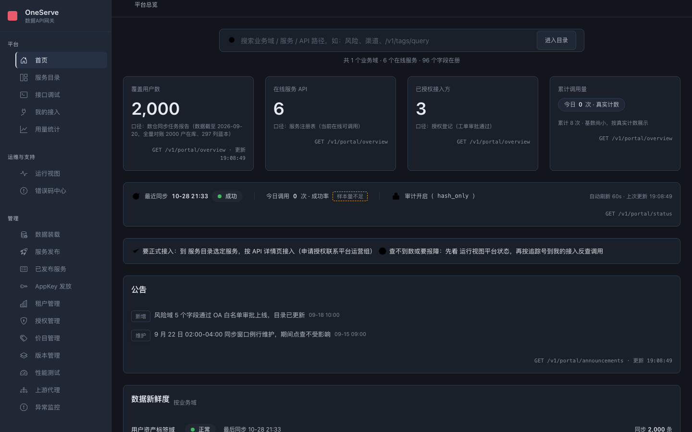
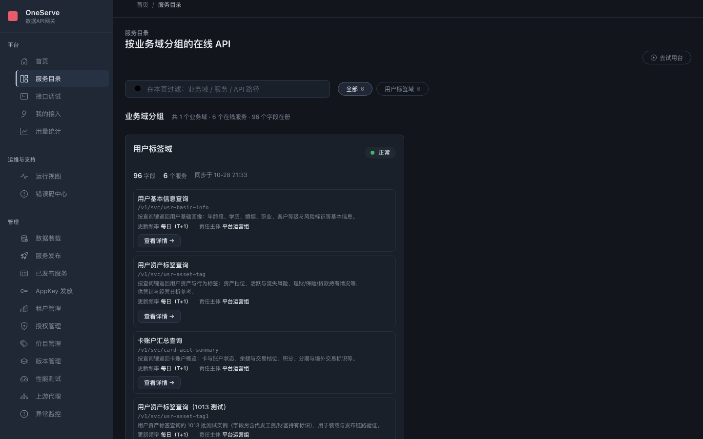
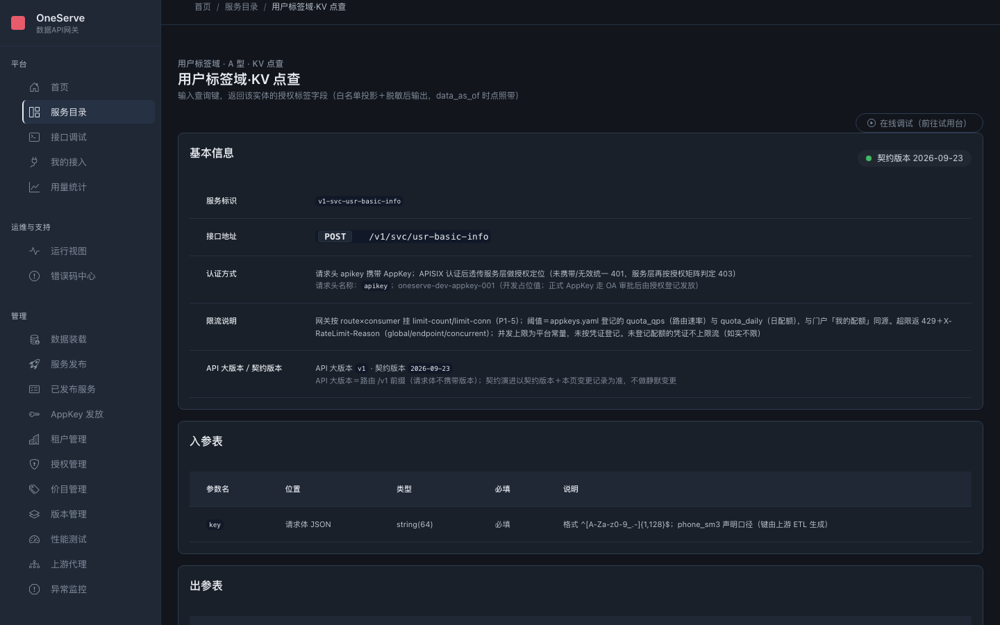
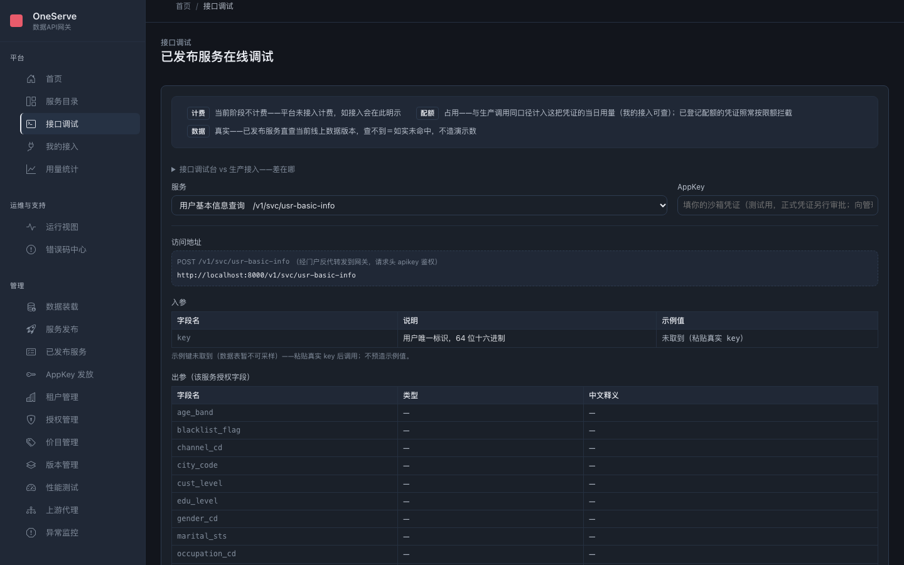
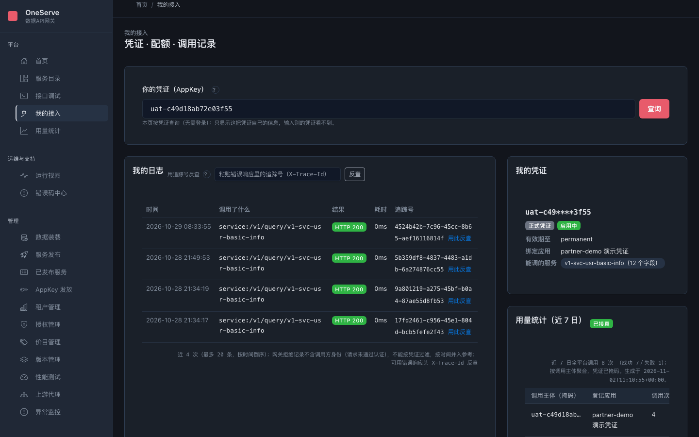
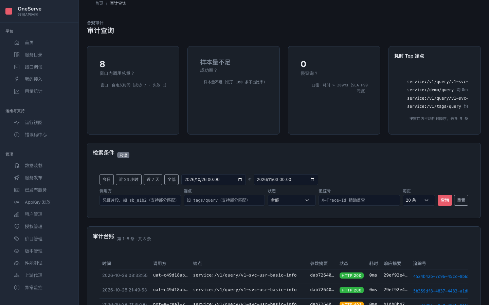
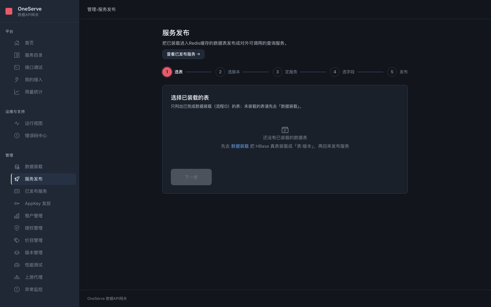
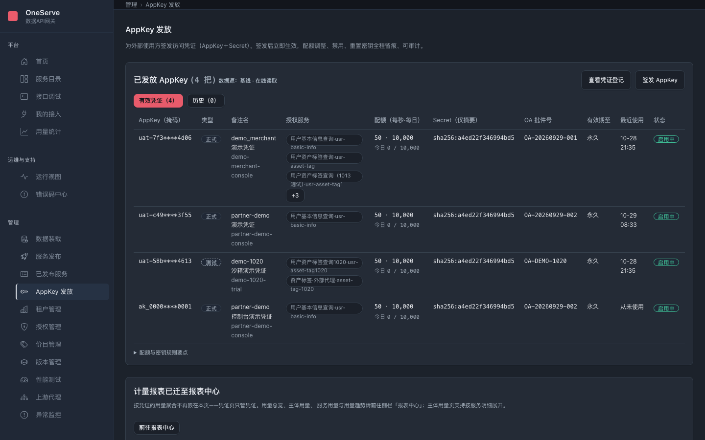
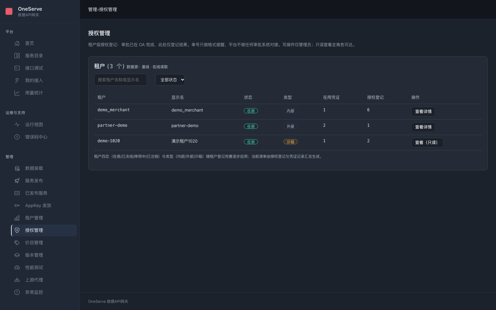
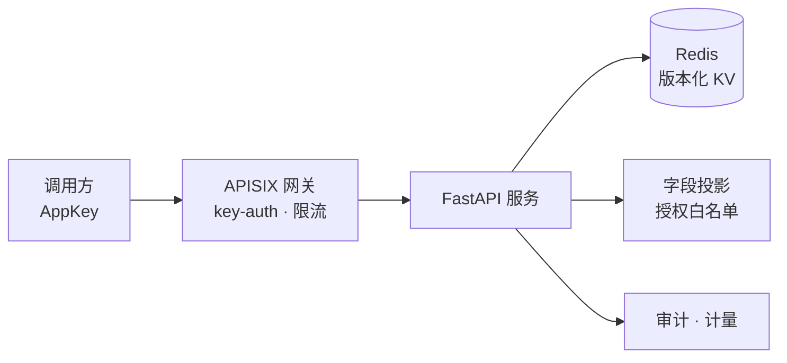

# OneServe 数据API网关

**把你已有的数据表，变成带权限的查询 API。** 数据不动，动的只是出口：谁能调、能看哪几个字段、调了多少次，一处管完。

[](https://github.com/suyukun/OneServe/actions/workflows/ci.yml)
[](docs/opensource/LICENSE)
[](service/Dockerfile)

English documentation: coming soon (see [docs/opensource/ROADMAP.md](docs/opensource/ROADMAP.md)).

## 它是什么

你有一批数据表——用户信息、资产标签、卡户汇总。想让内外部系统调用，但不想让人直连数据库，也不想每个接口手写一遍鉴权、限流和审计。

OneServe 把这件事变成三步：数据装载进 Redis（版本化 KV）→ 发布成一个 HTTP 查询接口 → 调用方拿 AppKey 来查。能看哪些字段由授权白名单决定，没批的字段后端零返回；每次调用留审计、计计量。自托管，一条 `docker compose up` 起完，演示数据自动灌好。

长什么样？往下看，30 秒就能在自己机器上跑起来。

## 30 秒跑起来

前置条件：Docker（带 Compose v2），别的什么都不用装。

```bash
git clone https://github.com/suyukun/OneServe.git && cd OneServe
docker compose up -d
open http://localhost:8000
```

> **国内网络提示**：Docker Hub 直连拉取可能超时——请先配置镜像加速（如 `docker.m.daocloud.io`），或手动拉取 compose 引用的镜像后再起栈。

首次运行会构建服务镜像（约 1-2 分钟；之后再启动只要几秒）。打开 http://localhost:8000，你会看到：首页 KPI、服务目录、接口调试台，全部免登录，演示数据已自动播种（150 条 `usr_basic_info` 记录）。



演示 AppKey 拿来就能 curl（同一条查询也可以在门户的接口调试页发）：

```bash
curl -s -X POST http://localhost:8000/v1/query/v1-svc-usr-basic-info \
  -H 'apikey: uat-c49d18ab72e03f55' \
  -H 'Content-Type: application/json' \
  -d '{"key":"demo-partner-0001"}' | jq .
```

预期结果：HTTP 200，`found: true`，12 个白名单字段（`gender_cd`、`age_band`、`city_code`、…）。

内置演示凭证（全部是仓库内置的演示值，不是生产密钥）：

| 租户 | AppKey | 试试 |
|---|---|---|
| `partner-demo` | `uat-c49d18ab72e03f55` | `v1-svc-usr-basic-info`，key 用 `demo-partner-0001`（即上面的 curl） |
| `demo_merchant` | `uat-7f3a9c21e5b84d06` | 资产标签类服务（SM3 查询键） |
| `demo-1020` | `uat-58b0d2e7a9c14613` | `v1-svc-usr-asset-tag1020` |

## 页面导览

门户给「用的人」，管理台给「管的人」。下面挑关键页各配一张实截（1440×900，暗色主题，演示数据）。

### 调用方视角

#### 服务目录 `/catalog`



按业务域分组浏览全部在线 API：路径、字段规模、更新频率、责任主体一眼可查。支持按关键词过滤。

#### 服务详情 `/catalog/<服务ID>`



单个服务的「说明书」：接口地址、认证方式、限流口径、入参出参表、错误码与解决方案。出参表就是「你能拿到哪些字段」的白名单口径——没批的不在列。

#### 接口调试 `/trial`



选服务、填 AppKey，浏览器里直接发起真实调用，不用自己搭客户端。出参按该服务的授权字段渲染——「白名单投影」是什么体感，试一次就懂。

#### 我的接入 `/my`



输入你自己的 AppKey：凭证状态与有效期、近 7 日用量、每次调用的日志（含追踪号反查）。免登录，凭证自己的信息自己查，不用问运营。

#### 审计查询 `/audit`



按时间窗、调用方、端点、状态检索审计台账：谁、什么时候、调了什么、结果如何、耗时多少。每次调用一条台账，「可审计」落在这里。

#### 用量报表 `/reports/overview`

调用量、调用方、服务面三个维度的用量总览，另有按服务/按主体/趋势三页（见 [PAGES.md](docs/opensource/PAGES.md) 报表专区）。演示栈的计量快照还没有调用记录时，页面如实显示空态——平台不造数。

### 运营视角

#### 服务发布 `/admin/publish`



五步向导把已装载的数据发布成查询 API：选表 → 选版本 → 定义服务 → 选出参字段 → 确认发布。发布完跟着引导配授权、发凭证，调用方就能用了。

#### AppKey 发放 `/admin/appkeys`



签发沙箱/正式凭证（正式件须 OA 批件号），按凭证配每秒/每日配额，支持轮换与禁用。secret 只存 sha256 摘要——界面上永远只看到掩码。

#### 授权管理 `/admin/grants`



租户 × 服务 × 字段白名单的授权登记全景：哪个调用方能看哪些字段、依据哪张 OA 单、生效区间到哪天。授权调整缺 OA 单号会被直接拒绝。

#### 数据装载 `/admin/load`

四步向导（选源 → 发现表 → 装载 → 结果）把 HBase 真表装载成 Redis 热数据版本，装载完就能发布成服务。演示档未起 HBase，页面会如实显示「不可达」——不假装有数据。

#### 异常监控 `/admin/monitor`

异常列表、按调用方/端点下钻（调用方一律掩码）、常驻容器健康探活、批量任务追踪。异常与「审计查询」同源同口径。

#### 月账单 `/admin/billing`

账期四态流转（草稿 → 已对账 → 已确认 → 已核销）＋双快照明细＋CSV 导出；出账是机器任务走命令行，页面上人工确认。

管理台还有租户管理、版本管理、价目管理、上游代理、已发布服务清单，共 11 页，逐页功能见 [PAGES.md](docs/opensource/PAGES.md)。

## 它是怎么工作的

调用方带 AppKey 请求，APISIX 网关做 key-auth 认证和限流；网关后面的 FastAPI 服务拿 key 到 Redis 的版本化 KV 里点查；出口上做字段投影（没批的字段零返回）、写审计、计计量。



两条补充：

- 默认 `docker compose up` 是 3 容器 demo 档（redis + service + portal），门户同源反代直通服务层，开箱即查；`bash scripts/up.sh` 起 6 容器 full 档，网关数据面 :9080 生效。
- 控制面状态放在 YAML 注册表（`service/services.yaml`、`auth_matrix.yaml`、`registry/appkeys.yaml`），可选镜像一份进 PostgreSQL 元数据库，配套迁移/对账工具。

<!-- 详细架构图见 docs/opensource/screenshots/architecture.png（待 lead 审查现成架构图后决定是否替换上方 mermaid；该文件当前尚未入库） -->

## 如实边界

1. **演示数据全是合成数据**：150 条 `usr_basic_info`、2,000 用户资产标签版本、三个演示租户与凭证，均为仓库内置演示值，不含任何真实个人信息。
2. **资产标签宽表查询可能返回空字段集**：`v1-svc-usr-asset-tag` 的列名蓝本与现役字段尚未完全对齐（见 [ROADMAP 已知限制 #2](docs/opensource/ROADMAP.md)）；主路径 `v1-svc-usr-basic-info` 不受影响。
3. **full 档查询需先注册网关 consumer**：`--profile full` 的数据面走 APISIX key-auth，需先经网关 Admin API 为凭证注册 consumer（管理台签发/启用凭证会自动同步；演示 consumer 的开箱自动注册在 [ROADMAP 已知限制 #1](docs/opensource/ROADMAP.md)）。demo 档经门户反代开箱即查。
4. **公网暴露不在本版范围**：本版面向内网/可信环境的自托管部署，公网发布所需的 TLS 终结、WAF 等加固不在内。
5. **SM3 不是平台核心能力**：SM3 摘要仅作为国密合规场景的可选摘要算法存在（标准摘要算法、可替换实现，如演示通道查询键生成）。

## 参与贡献

- 报问题：先搜 issue，一问题一 issue，贴可复现步骤与环境，流程见 [CONTRIBUTING.md](docs/opensource/CONTRIBUTING.md)。
- 安全问题：**不要开 issue**，走 [SECURITY.md](docs/opensource/SECURITY.md)。
- 跑测试：`python3 -m pytest tests/ -q -rf`（CI 全量基线：1272 passed、4 skipped、0 failed）。

## 许可证

以 **Apache License 2.0** 发布，全文见 [LICENSE](docs/opensource/LICENSE)。
<!-- NOTE: the LICENSE file currently lives at docs/opensource/LICENSE; it is planned to move to the repository root (becoming ./LICENSE). When it moves, update this link to point to ./LICENSE. -->

## 文档索引

| 文档 | 内容 |
|---|---|
| [页面功能导览](docs/opensource/PAGES.md) | 门户 14 页＋管理台 11 页，逐页功能与入口路径 |
| [ARCHITECTURE.md](docs/opensource/ARCHITECTURE.md) | 架构与数据流详解 |
| [ROADMAP.md](docs/opensource/ROADMAP.md) | 已知限制与计划（不承诺时间表） |
| [CHANGELOG.md](docs/opensource/CHANGELOG.md) | 变更记录 |
| [SECURITY.md](docs/opensource/SECURITY.md) | 安全问题报告流程 |
| [CONTRIBUTING.md](docs/opensource/CONTRIBUTING.md) | 贡献流程 |
| [screenshots/](docs/opensource/screenshots/) | 本 README 的页面截图图源 |
