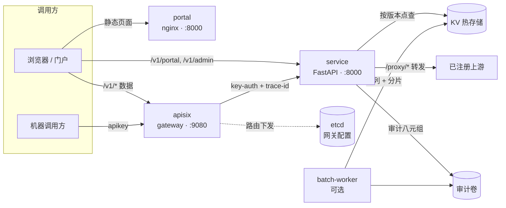

# OneServe 架构说明

| | |
|---|---|
| 文档状态 | 目标态（target state），随首个公开版本定稿 |
| 读者 | 首次接触本项目的开发者、运维人员与架构评审者 |
| 范围 | 运行时组件、核心概念、请求路径、部署形态、技术选型与已知边界 |
| 最后更新 | 2026-10-28 |

> 本文描述无登录模式（ADR-0029）落地后的目标态；组件与端口以 `docker-compose.yml` 为准，行为以 `service/` 的实现与测试为准。

## 1. 一句话定位

**OneServe 是一个数据API网关：把数据表发布为受治理的 HTTP 查询 API，同时提供
A 型键值标签点查与 B 型声明式上游代理，并以管理面统一承接注册、授权、发布与审计。**
（产品命名 2026-10-29 统一为「OneServe 数据API网关」；历史叙述中的旧称见 CHANGELOG/ADR。）

它解决的是“同一张表被多个调用方以不同字段口径访问”时的重复开发：服务注册表描述
数据与字段，授权矩阵描述谁能看哪些字段，网关与服务层负责鉴权、投影、脱敏、审计和限流。
调用方拿到的始终是稳定 JSON，而不是数据库连接串或底层表结构。

## 2. 架构总览



- **portal**：静态门户与管理台（nginx，非 root 运行）。同源提供页面、静态资源和
  `/v1/portal/*`、`/v1/admin/*` 的反向代理；业务数据请求转发到网关。demo 档（网关
  不在栈内）时业务请求经内置降级通道直连服务层，页面功能不缺（见下「两档部署」）。
- **apisix**：唯一对外数据面入口（`:9080`）。按路由做 API Key 鉴权、注入 trace id、
  转发到服务层；路由配置存放在 etcd，不写死在网关容器里。full 档组件（demo 档不起）。
- **service**：FastAPI 薄服务层。承载 A 型查询、B 型代理、批量任务 API、管理 API、
  审计写入；不直接对外发布端口，只经网关或门户反向代理到达。启动前自动灌演示数据
  （redis 空 → seed，哨兵键幂等，复用 `scripts/seed_demo.sh` 与 `sync/` 装载链）。
- **etcd**：APISIX 的配置存储，不是业务数据库。保存路由、上游、消费者等服务网关对象。
  full 档组件（demo 档不起）。
- **KV 热存储**：Redis 兼容的键值库（`noeviction` + AOF `everysec`）。保存按版本组织的
  标签数据、版本元信息、批量任务队列与统计计数。
- **batch-worker**：可选 sidecar，与服务层同镜像、不同入口。消费 Redis FIFO 队列，
  分片读取、分片落盘、按检查点续跑。full 档组件（demo 档不起）。
- **已注册上游**：B 型代理的目标。参考栈自带一个示例上游用于演示；生产部署替换为
  真实上游即可。

宿主机只发布两个端口：`:9080` 是数据面 API，`:8000` 是门户页面。etcd 的 `:2379`、APISIX
Admin API 的 `:9180`、服务层的 `:8000` 均只在容器网络内可达。

**两档部署（一键开箱批 2026-10-28）。** compose 服务分两档：默认 `docker compose up`
＝**demo 档（3 服务）**——redis/service/portal，门户、目录、管理台、演示查询与演示
AppKey 全功能可用，演示数据在服务启动前自动灌入（redis 空 → seed，哨兵键幂等）；
`docker compose --profile full up`（或 `bash scripts/up.sh`）＝**full 档（6 服务）**——
etcd/apisix/batch-worker 随档加入，`:9080` 机器数据面（key-auth/限流/网关侧审计）生效。
demo 档下 `/healthz` 对网关/etcd 如实报 `degraded`，管理台监控页对 full 档组件如实标注；
门户 nginx 对网关反代内置 502 降级通道（直连服务层，`/v1/svc/<name>` 自动改写为服务层
的 `/v1/query/v1-svc-<name>`），full 档该通道不触发、网关语义零变化。

## 3. 核心概念

**A 型服务（A-type，KV 点查）。** 调用方用一个不透明键查询一条已发布的标签记录，
服务层按注册表解析键空间与版本，按授权矩阵裁剪字段，再按规则脱敏后返回。它是读多写少、
单键点查的形态；批量场景走异步任务，不把大键列表塞进一次同步请求。

**B 型服务（B-type，声明式代理）。** 平台不复制上游数据，而是把 `upstreams.yaml` 中
声明的上游注册为代理条目，按最长前缀匹配把 `/proxy/*` 请求转发出去。方法、请求头与
请求体按白名单转发，响应原样回传；发布条目时同步向网关下发路由，下线时删除路由。

**服务注册表（service registry）。** `service/services.yaml` 是 A 型服务的唯一权威源：
一条记录包含 `service_id`、路由、键模板、字段清单、字段空间、超时与限流参数。新增服务
通常只改这一份 YAML；服务层按 mtime 轮询热加载（默认 30 秒），网关路由由渲染器幂等下发，
不需要重启容器。

**键空间与版本（key space / version）。** 每个数据集一个命名空间，例如 `tags:<dataset>`。
别名键 `<namespace>:latest` 指向当前版本，数据键形如
`<namespace>:<version>:<key>`，版本元信息记录行数、字段数、来源、校验和与
`data_as_of`。版本号采用 `YYYYMMDD`；读取永远先解析别名，再读对应版本的数据键，
因此换版本是原子切换，不会读到半新半旧的数据。

**无登录模式（ADR-0029）。** 开源版不设人机登录与账号体系：打开门户即是首页，管理台
公开可访（开箱即用演示优先，分叉决策见 `ADR-0029-开源版无登录模式.md`）。机器调用方
仍受完整鉴权约束——数据面 `/v1/query/*`、`/v1/tags/query`、`/v1/batch/*`、`/proxy/*`
走网关 AppKey（key-auth）＋服务层授权矩阵双重校验；`/v1/admin/*` 凭证管理端点由
AppKey 凭证体系与部署侧网络边界保护。历史登录墙（OIDC/native 双模、三角色 RBAC）
已随分叉拆除，模块尸体留待 v0.1.1 清理。

**审计管线（audit pipeline）。** 每次受治理调用写一条八元组：时间、调用方、端点、
参数摘要、状态码、时延、响应摘要、trace id。参数与响应只存 SHA-256 摘要，不落明文；
默认写 JSONL 并由预写日志（WAL）兜底，可选 Kafka 直投。审计是“可追溯”而不是“可还原请求内容”。

**健康探针（health probe）。** `/healthz` 返回整体状态与分组件明细：Redis 不可用是
致命错误（HTTP 503），HBase、网关、etcd 不可达只记为 `degraded`（HTTP 200）。
service 容器的健康检查调用同一端点；batch-worker 另用“进程存在 + 队列可达”探针。

**批量任务（batch jobs，可选）。** 提交后返回 `job_id`，任务在 Redis 中排队，由
batch-worker 串行消费，按分片读取、分片写 JSONL，支持取消、重试与断点续跑。默认配额为
单任务 100 万键、每租户 1 个并发任务、每日 500 万键；这些值都可由环境变量覆盖。

## 4. 一次 A 型查询的完整路径

下面以浏览器从门户发起为例；机器调用方直连 `:9080` 时少一跳同源反向代理。

```http
POST /v1/query/<service_id> HTTP/1.1
Host: localhost:8000
apikey: <consumer-key>
Content-Type: application/json

{"key": "<opaque-customer-key>"}
```

1. **浏览器 → 门户 → 网关。** 浏览器在门户页面发起同源请求（`apikey` 头），
   先到 `:8000`；nginx 的 `/v1/` location 反代到 `:9080`。`/v1/portal/*` 与
   `/v1/admin/*` 直接到服务层；机器调用方直连 `:9080` 时跳过门户。
2. **路由匹配。** APISIX 按 URI 与方法匹配已下发路由。未匹配返回 404；匹配后进入
   `key-auth` 插件。
3. **网关鉴权。** `key-auth` 用 `apikey` 查找消费者。缺失或无效直接 401，请求不会
   到达服务层；有效则把消费者身份保留在请求头中。
4. **追踪与转发。** `request-id` 插件生成或透传 `X-Trace-Id`；随后 APISIX 把请求
   转发到 `service:8000`，保留 `apikey` 与 trace 头。除了网关已完成 API Key 鉴权这一
   事实，服务层不信任任何输入，仍会重新做授权判断。
5. **注册表解析。** 服务层按 `service_id` 查注册表。未注册返回
   `404 service_not_found`；服务已下线同样走这一分支，不会泄露注册表内容。
6. **请求校验。** 解析 JSON、校验键格式（默认 `^[A-Za-z0-9_.-]{1,128}$`），并检查
   单次键数上限。默认每个请求只允许一个键，超过返回 400；多键请走批量接口。
7. **授权判定。** 以 `tenant + appkey + service_id` 查授权矩阵，取该租户对本次服务的
   字段白名单。没有有效授权返回 `403 service_not_granted`。
8. **读取版本指针。** 读取 `<namespace>:latest`。指针不存在说明数据尚未上线，返回
   `503 data_not_ready`，服务层不会回退到旧版本或空结果。
9. **读取数据键。** 用指针中的版本拼出数据键并读取。键不存在时返回
    `found: false, fields: null`，这是“查无此人”的诚实空值，不是错误。
10. **投影与脱敏。** 只保留白名单字段，再按服务配置的脱敏规则处理。白名单之外的字段
    不会出现在响应里，也不会进入响应摘要。
11. **组装响应与审计。** 返回 `service_id`、`key`、`tenant`、`found`、`fields`、
    `data_as_of`、`live_version`，并附加 `X-OneServe-DataSource` 头；同时异步写八元组，
    参数与响应只记摘要，写入失败由 WAL 兜底，不阻塞响应。
12. **返回 JSON。** 网关原样回传；客户端收到 200 与下述结构。

```json
{
  "service_id": "v1-svc-example-tag",
  "key": "<opaque-customer-key>",
  "tenant": "tenant-a",
  "found": true,
  "fields": {"segment_band": "C", "risk_band": "A"},
  "data_as_of": "2026-10-27",
  "live_version": "20261027"
}
```

## 5. 部署形态

参考栈由七个常驻服务（容器）组成。五个是核心，批量 worker 与示例上游按需启用：

| 组件 | 核心 5 | 标准 6 | 参考 7 | 说明 |
|---|:---:|:---:|:---:|---|
| portal | ✓ | ✓ | ✓ | 静态门户 + 管理台 |
| service | ✓ | ✓ | ✓ | API、鉴权、审计、管理 |
| KV 热存储 | ✓ | ✓ | ✓ | 点查数据与任务队列 |
| apisix | ✓ | ✓ | ✓ | 数据面网关 |
| etcd | ✓ | ✓ | ✓ | 网关配置 |
| batch-worker | — | ✓ | ✓ | 异步批量任务 |
| 示例上游 | — | — | ✓ | B 型链路演示，可替换/删除 |

- **分档**：核心 5 是最小可查询部署（能发布、完成 A 型点查，不含批量）；
  标准 6 增加 batch-worker；参考 7 再增加示例上游用于验证 B 型转发。
- **可选叠加**：Kafka（流式审计）与 HBase（冷存/宽表装载）各用独立 compose 文件，
  均不在默认启动路径；启用 Kafka 后全栈为八个常驻容器（另有一次性 topic 初始化任务）。
- 所有组件跑在同一个容器网络内，只有 `:8000` 与 `:9080` 发布到宿主机。单机
  Docker Compose 即可完成部署，不依赖任何托管云服务。

## 6. 技术选型

| 层 | 选型 | 替代与取舍 |
|---|---|---|
| 边缘网关 | Apache APISIX 3.18 | Kong、Envoy Gateway、裸 NGINX。选 APISIX 是因为路由可动态下发、`key-auth`/`request-id` 等插件开箱可用，且配置天然存 etcd。 |
| 网关配置 | etcd 3.5 | Consul、关系库。etcd 是 APISIX 的原生配置后端，少一个组件、少一层同步。 |
| API 服务 | Python 3.13 + FastAPI + Uvicorn | Go、Java。异步 I/O 与类型化请求模型适合薄服务层；若未来出现 CPU 密集路径，再把该路径下沉到 Go，而不是整体重写。 |
| KV 热存储 | Redis 7（`noeviction` + AOF `everysec`） | Valkey 8 是协议兼容的 drop-in 替代，许可更干净；KeyDB、Dragonfly 也可评估。当前代码只用 GET/SET/HGET/管道等窄子集，替换成本低。 |
| 门户 | nginx-unprivileged 1.27 + 静态多页应用（MPA） | SPA、Node SSR。静态站零运行时构建、内存占用低；管理台不需要前端框架即可工作。 |
| 认证 | 无登录模式（ADR-0029）：无人机登录/账号概念 | 历史形态（本地账号 users.yaml＋bcrypt＋HS256 JWT、外源 OIDC IdP）已随开源分叉拆除，代码尸体保留至 v0.1.1；机器鉴权走网关 AppKey（key-auth）＋服务层授权矩阵。若未来恢复人机登录，回 git 史与 ADR-0029 取回实现。 |
| 审计 | JSONL + WAL（默认）；Kafka（可选） | 直接写数据库、Loki。本地优先，不要求部署消息中间件；Kafka 模式用于多消费者与对账期。 |
| 批量执行 | 同镜像 sidecar + Redis FIFO | Celery、RQ。不引入额外 broker；任务状态、队列与结果都在已有 KV 中。 |
| 冷存/批量源 | HBase（可选） | Parquet、ClickHouse、对象存储。只在已有表源需要装载时启用，不属于核心依赖。 |
| 编排 | Docker Compose | Kubernetes。单机参考部署优先保证“一条命令起栈”；需要多副本与自愈时再迁移。 |
| 可观测 | `/healthz` + 结构化日志 + 审计 | Prometheus/Grafana 全家桶。当前只保留排障必需的最小面，指标以审计与计数快照提供。 |

## 7. 运行与可靠性

| 故障 | 系统行为 |
|---|---|
| KV 热存储不可用 / 无版本别名 | 查询返回 503，不返回旧值或空标签集；`/healthz` 报 `error`。 |
| etcd 不可用 | 已下发的网关路由继续服务；新的发布/下线无法生效。 |
| service 不可用 | 网关返回 502；portal 静态页面仍可打开，但数据与管理面不可用。 |
| batch-worker 停止 | 任务留在 Redis 队列；进程恢复后按检查点续跑。 |
| Kafka sink 失败 | 审计降级回本地 JSONL，不丢调用记录。 |

- **启动顺序**：etcd → apisix；KV 热存储 → service；service 与 batch-worker 共享
  镜像、不同入口。portal 无强依赖，可独立启动。
- **热加载**：注册表按 mtime 轮询（默认 30 秒），上游注册表同样按 mtime 收敛；
  发布与下线由管理面触发，网关路由幂等下发。
- **扩容**：service 的请求处理无状态，可在网关后增加副本；KV 热存储当前是单主，扩容前先评估
  分片或读写分离；batch-worker 串行消费，增加副本前先确认队列隔离。
- **备份**：KV 的 AOF 卷、审计卷、`services.yaml`、`auth_matrix.yaml`、
  `upstreams.yaml` 是恢复所需的最小集合。
- **安全**：无登录模式下管理台公开可访——部署侧必须以网络边界（内网/安全组/前置
  反代）保护门户与管理端口；数据面与凭证面仍走 AppKey 鉴权（key-auth＋授权矩阵＋
  限流）；审计不落明文参数。

## 8. 代码结构与验证

```text
service/app/              API、注册表、执行器、审计、批量、管理面（历史登录模块尸体保留至 v0.1.1）
service/services.yaml     A 型服务注册表
service/auth_matrix.yaml  租户 / 凭证 / 字段白名单
service/upstreams.yaml    B 型上游注册表
configs/apisix/           网关启动配置与路由渲染
configs/nginx/            门户站点配置
portal/                   静态门户与管理台
tests/                    pytest 套件（111 个 test_*.py）
docker-compose.yml        参考栈
```

- 测试套件按 `tests/test_*.py` 动态枚举，当前 **111** 个测试模块；新增套件自动入列。
- 直接依赖 **12** 条（`service/requirements.txt`），锁定闭包 **65** 包
  （`service/requirements.lock`）；运行与分发以锁文件为准。
- 最小冒烟：无 Key 请求网关返回 401，带 Key 返回 200；一条 A 型查询返回 JSON；
  一条 B 型请求经代理返回上游响应。

## 9. 已知边界

- **单机参考部署**：默认形态不提供多副本、自动故障切换、跨可用区容灾或 SLA 承诺；
  发布由管理面显式触发，不含定时调度、自动发现或自动回滚。
- **不是通用 SQL 网关，也不是数据集成工具**：A 型只做单键点查，不做任意查询、
  Join、聚合或即席分析；B 型只做注册与转发，不替上游定义语义。
- **无登录模式的边界**：开源版不提供人机登录、账号、角色与审计外的操作者归属；
  对外暴露管理台意味着信任边界前移到网络层——公网部署必须自加访问控制
  （见 `SECURITY.md` 与 ADR-0029 的部署前提）。
- **审计不是合规归档**：八元组用于排障与计量，只存摘要；WORM、长期归档与法务留存
  需外接对象存储或日志平台。
- **传输与静态加密**：TLS 可由前置反向代理终止，平台不管理证书；数据卷落盘加密
  依赖宿主机或存储层，平台本身不提供透明加密。
